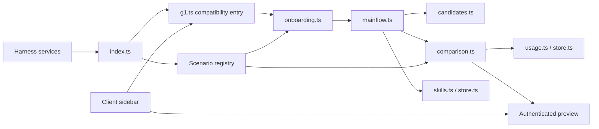

# Architecture and Code Map

Current version: g2.5. See the [framework](FRAMEWORK.md) for product scope. Executable schemas in source define the authoritative fields. This map helps contributors locate changes without copying the core flow into each scenario.

## Composition

One TypeScript package builds the host plugin and React sidebar. Harness supplies models, credentials, Skill registration, Agent sessions, browser authentication, and communication. RSI owns user authorization, candidates, comparisons, versions, and accounting.

## Responsibilities

| Change | Entry point | Boundary to preserve |
|---|---|---|
| Skill types, recognition, output format | `src/scenarios/` | Does not own authorization, tokens, or ACTIVE |
| Task interception and explicit `/skill-name` | `src/onboarding.ts` | Requires an explicit Skill or a matching scenario; does not intercept all chat |
| Confirmation, clarification, iteration, adoption | `src/mainflow.ts` | Check revision, source, digest, and budget before writes |
| Candidate validation | `src/candidates.ts` | Authorized copies only, immutable after sealing; no output quality decisions |
| Paired execution, compilation, links | `src/comparison.ts` | Same frozen conditions, two independent requests; failures remain failures |
| Usage and time | `src/usage.ts`, `src/comparison-metrics.ts` | Record before dispatch; unknown is not zero |
| State and migration | `src/store.ts` | SQLite transactions, idempotent operations, retained history |
| Content-addressed Skills | `src/skills.ts` | Separate original directories, immutable objects, and active pointers |
| Content-addressed policy versions | `src/policy-versions.ts`, `src/store.ts` | Canonical read-only objects, parent provenance, immutable batch authorization and exact run binding |
| Earlier observation/design preparation | `src/g1.ts`, `src/frontend.ts` | Preserve protocol compatibility; new scenario logic belongs elsewhere |
| Charts and feedback | `src/client/comparison.tsx` | No client-side billing, scoring, or direct ACTIVE writes |
| Web-specific guidance | `src/client/design-start.tsx` | Frontend-only assistance, not a closed taxonomy for core input |
| Repository policy execution and questions | `src/policy-contracts.ts`, `src/policy.ts`, `src/policy-evaluation.ts`, `src/policy-source-qa.ts`, `src/policy-execution.ts` | Fixed routes/tools, exact source/intent, host-owned answers and one shared ledger; independent native children |

Historical names such as g1, mainflow, and g0.sqlite remain to reduce compatibility cost. Candidate validation, comparisons, and scenarios were extracted along actual responsibilities; there is no service or package for every object.

## Call chain

1. `index.apply` opens storage, provides the scenario registry, registers usage observation, and composes business services.
2. `onboarding` resolves explicit Skills; otherwise it uses scenario `matchesRequest`. Directory-backed non-web Skills fall back to text.
3. `mainflow.startPage` (historical internal name) seals the baseline, pins the scenario version, creates a confirming card, and pauses the dependent task.
4. `flow_authorize` freezes complete input, paths, preferences, and budget. Generation returns candidate, clarification, or unchanged.
5. `checkCandidate` validates and seals files, entering review. The user can use the original review path or start a comparison.
6. `flow_compare` freezes both inputs and a separate budget. Core code calls the model; the scenario compiles. Each output records its digest, status, and duration.
7. `flow_choose` verifies the exact candidate and expected ACTIVE. If comparison was started, candidate compilation and related usage must be confirmed. No functional/aesthetic score is read. The host then binds the version and dispatches an ordinary task.
8. `flow_revise` creates a child task with `parentId` and the selected previous version as a read-only reference. An unadopted parent candidate does not enter ACTIVE; parent evidence remains.

Comparison is a tool-free request, not another Agent Loop. It does not change daily-session Skill bindings. After adoption, actual project work continues through native Harness tools and its Agent Loop.

The [policy gate](POLICY-CONTRACTS.md) uses a separate concrete path. `scripts/policy-comparison.ts` seals and authorizes one fixed-case batch, then sequentially hands the exclusive SQLite connection to two independent native SDK children. The controller closes before launch and reconnects only after child exit; an explicit existing-batch handoff suppresses startup recovery during that interval. Ordinary store open always recovers unfinished work. The worker verifies its active binding, installs frozen snapshot tools and observes requests; it does not create or finish the shared batch. `reserve` enforces version integrity and cumulative batch/run limits. The parent retains events/envelopes and cleanup observations before finishing each run. `src/policy-evaluation.ts` derives fixed facts/citations and infrastructure results from that evidence and the shared ledger. No generic runner is added to `SkillScenario`.

`src/policy-generation.ts` uses the existing native LLM service for one tool-free proposer request. `policy-generation-contracts.ts` owns the restricted view and response schema; it does not import the casebook. The host installs the existing usage observer (production plugin or isolated fixture), which verifies the frozen prompt and generation owner before dispatch. The store checkpoints partial output and atomically registers candidate provenance/task completion after scope and usage checks. `authorizeGeneratedPolicyEvaluation` creates a separate exact-lineage batch without calling a model. `executePolicyComparison` runs that already-authorized batch; the manual comparison fixture reuses the same executor. No generation result triggers evaluation or adoption by itself.

## Scenario interface

`SkillScenario` has four responsibilities:

- `info`: stable ID, version, readable label, and HTML/text presentation kind.
- `matchesSkill` / `matchesRequest`: selection; general text is a fallback and does not automatically intercept chat.
- `instructions`: shared output instructions, frozen together with user input.
- `compile(output, signal)`: validate output and return a bounded artifact plus check details. It receives neither a database nor an activation callback.

`ctx.rsiScenarios.register` returns an unregister function. Duplicate IDs fail. The most recently registered specific scenario takes priority, with text as fallback. Tasks pin versions; removed or changed implementations cannot silently continue a comparison. Increment the version when instructions or compilation semantics change.

This is an API for trusted host code, not a plugin security sandbox. Third-party host code has the trust level of other host plugins, even though the interface does not expose state-writing helpers.

## Data and compatibility

| Data | Authority | Storage |
|---|---|---|
| SkillSnapshot, UsageAttempt, binding | `src/contracts.ts` | SQLite and `rsi/objects/<digest>` |
| Revision task, parent, scenario, reference | `src/mainflow-contracts.ts` | `g1_state.mainflow.tasks` |
| Comparison budget, runs, artifact digests | `src/comparison-contracts.ts` | Task comparison |
| Scenario and artifact structure | `src/scenarios/contracts.ts` | Scenario code, snapshots, content files |
| Web operations | `src/g1-contracts.ts` | `g1_operations` receipts |
| Compiled artifacts | SHA-256 of content | `rsi/artifacts/<digest>` |
| Policy content and version provenance | `src/policy-contracts.ts`, `src/policy-versions.ts` | `rsi/policies/<digest>.json`, `policy_versions` |
| Policy batch authorization and run progress | `src/policy-contracts.ts`, `src/store.ts` | `policy_batches`; accounting reuses `attempts` |
| Fixed policy case and evaluation evidence | `src/policy-evaluation.ts`, `src/policy-contracts.ts` | Optional spec/evidence/evaluation/resource fields on policy batches; old v7 rows remain unevaluated |
| Policy choice history and immutable pilot-session bindings | `src/policy-review-contracts.ts`, `src/policy-review.ts`, `src/client/policy.tsx` | Additive `policy_choices`, `policy_sessions`; reuse `g1_operations` and daily `attempts` |
| Human-authored repository question packs | `src/policy-qa-inputs.ts`, `src/policy-manual-qa.ts`, `src/client/policy-qa.tsx` | `policy_qa_packs` draft/seal receipts and `repository-question-packs/<digest>.json`; host-only answers, exact source/spec binding |
| Policy generation authorization, partial response, candidate provenance | `src/policy-generation-contracts.ts`, `src/policy-generation.ts`, `src/store.ts` | Additive `policy_generations`; existing attempt table with a distinct generation owner |

SQLite 6 added scenario/comparison defaults. SQLite 7 initially added policy version/batch tables without rewriting v6 business JSON or terminal ledger/receipt/binding rows. This replaces the plan's proposed `executionPolicies` JSON section: concrete indexed tables avoid rewriting unrelated historical data and need no unused adoption fields. Failed migrations roll back rather than clear data. Back up the database, objects, policy objects and artifacts together. Startup lifecycle recovery still records interruptions of unfinished work.

The generation gate appends a third policy table and optional provenance/link fields within this unreleased v7 development path. Existing v7 rows remain unchanged; older strict v7 readers may reject new rows. Downgrade requires the complete stopped-host backup. The review gate additionally appends `policy_choices` and `policy_sessions`. Policy-wide accounting includes generation, evaluation and bound daily sessions; a batch-specific query excludes generation costs. Late usage settlement never rearms an interrupted task.

The current single-machine JSON state is bounded: 256 tasks and 64 Skills. Limits are not automatic cleanup policies. Reaching them requires explicit migration or archival, never deletion of old accounting.

## Accounting, concurrency, and recovery

- Generation uses the revision task ID as ownerId; comparison uses its own ID, with separate sessionIds per side. Daily work retains the session owner.
- Baseline runs first, candidate second. Each is authorized once, without automatic retries. Numbers in model output are not usage evidence.
- Tokens come from the ledger. A monotonic host clock measures each request, compilation, and artifact sealing, excluding user waiting. Unreliable duration after interruption remains unknown.
- During generation/comparison, a task cannot change reference, adopt, or create another iteration; stopping remains possible. Other tasks can exist independently. Duration is an observation, not a contention-free benchmark.
- Stop/disposal aborts plugin-owned requests and reconciles state. Restart marks in-flight work failed/interrupted without paid replay. Completed comparisons remain viewable.
- ACTIVE updates check the expected previous version; concurrent cards cannot overwrite newer state. Session bindings are immutable.

## Preview boundary

`ctx.connection.fetch` registers `/api/rsi-preview`, reusing Harness Host/Origin checks and browser authentication. Reads verify the content digest and serve only complete compiled artifacts.

HTML uses CSP sandbox with scripts allowed but no same-origin privilege. CSP restricts networking, form submissions, external resources, and nested frames. Sidebar iframes add sandboxing. The same authenticated link opens a full-size local preview; this is not hosting.

Never execute preview HTML with Harness same-origin privileges or pass model-generated build commands straight to the host shell. External dependencies and multi-file projects need a controlled execution environment and cleanup contract first.

The review gate reuses the `/rsi` sidebar, long-poll snapshots and exact-operation receipts. `checkedPolicyReview` rederives infrastructure and ledger checks before committing a workspace choice; the last append-only choice is its active pointer. Session intent and receipt commit before native provisioning. Creation setup and synchronous native resume announcement install scoped prompt/tools before assembly, and the model-selection event precedes the first header. Native workspace attachment is retried against the same binding after failure. Only explicit `rsi-policy/` sessions inherit a choice; ordinary sessions never do. The observer and store independently restrict fixed routes and cumulative daily usage, and daily session costs join policy totals without entering evaluation batch totals. Stop the host before upgrading; hot plugin replacement with already running external Agents is not a supported migration path.

Final review (2026-10-16): fresh adoption verifies both version objects. Restore and session creation from an existing approval verify the selected object plus the unchanged original generation/evaluation proof, so loss of the other object does not block recovery. The scoped request hook restores a missing native-resume output cap from the binding; the observer rejects explicit conflicts. Workspace changes remount the policy card and discard unconfirmed intent. See [final review](POLICY-FINAL-REVIEW.md).

Real worktree capture (2026-10-16): `src/policy-snapshot.ts` accepts an explicit checkout/file selection, rejects unsupported/sensitive input, checks bounded read-only descriptors twice and seals exact worktree text. It reuses `policyFilesSchema` and policy versions' bounded canonical JSON publication. `repository-snapshots/<digest>.json` is independent source storage; optional `sourceSnapshot` provenance is checked against conditions' embedded files. Workers continue reading in-memory text, without filesystem authority for the provenance root. The existing casebook/adoption routes are unchanged; the new command verifies offline source transport only. No database schema change or root-wide scan. See [snapshot contract](POLICY-SNAPSHOT-CONTRACTS.md).

Sidebar source entry (2026-10-16): `policy-inputs.ts` supplies the same browser-safe file/route/limit structures and guards, while `policy-contracts.ts` retains host digest verification. `policy-review-contracts.ts` defines preview/seal/source-session commands and the single persisted source row. `applyPolicyReview` checks registered workspace/state before capture, recaptures on sealing, rechecks the registry path and global revision after async reads, and drains capture work on disposal. `policy_sources` stores full frozen preview conditions; normal snapshots project manifests only and one explicit read endpoint serves a full body. Publication precedes the transactional seal/receipt; failed commits leave an unreferenced object with no session authority. Optional session `sourceId` binds exact sealed conditions, rechecked on creation/resume/dispatch. Historical sessions without it resolve their original batch as before. The existing native Agent, capability guard and daily ledger are reused. See [source UI report](POLICY-SOURCE-UI-REPORT.md).

Sidebar authorization (2026-10-16): `policy-authoring.tsx` confirms exact baseline/source generation and a separate evaluation budget through the existing command model. `policy-review.ts` schedules each committed intent once, tracks cancellation and drains work. `store.ts` reuses generation/batch tables and receipts in one outer transaction, validates optional source/authorization provenance at startup and never launches work on open. The generator prompt is unchanged; selected source text, casebook and evaluation results are excluded. `repository-source-v1` derives a fixed first-line/citation task from the exact sealed source, with the same conditions for both sides. See the [authorization contract](POLICY-AUTHORIZATION-CONTRACTS.md).

The old SDK executor closes its SQLite controller for worker handoff, so the live sidebar uses the concrete `policy-execution.ts` path. The host retains the only database connection. Two sequential `policy-worker.ts` children run the native Agent Loop, receive frozen source/tools without a database or provider credentials, and forward bounded model requests through `policy-process-contracts.ts`. The host LLM observer reserves/settles the same batch-owned ledger before adapter dispatch. Parent-observed envelopes plus native tool/result/turn events reuse the full-task checker. Build emits one adjacent worker file. PID/home/parent/run ownership is recorded before launch and validated by a private marker; source provenance is never used as a cleanup path. Cancellation drains owned work. On controller loss, a child removes only its verified temporary cwd and exits; absent complete evidence remains interrupted/incomplete. Unknown ledger usage and original resource ownership survive restart without replay.

Fixed source questions reuse this path. `policy-source-qa.ts` owns one reviewed manifest and three host answers; `policy-evaluation.ts` resolves the selected versioned specification and requires each question's source reads plus the existing native/ledger/citation checks. The host pins the reviewed manifest digest independently of installed examples, and fingerprints that identity/definitions. Fixture preparation rejects altered examples; grading uses the pinned identity and frozen source. `policy_evaluate.caseId` is optional: absent retains first-line checks, present binds an exact fixed question and its conditions/answer digest. The browser receives availability and chooses a case, never supplies an evaluator or answer. No question pack or evaluation spec is sent to a child or the proposer. Source-evaluation provenance/receipt guards cover both variants, including sessions resumed from an approved batch. See [fixed question contracts](POLICY-SOURCE-QA-CONTRACTS.md).
