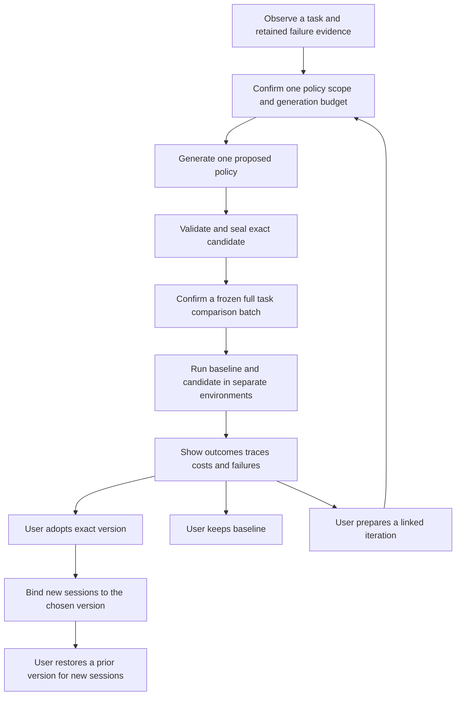

# Controlled Agent Evolution Feasibility and First Pilot

Date: 2026-10-15. Status: proposal with local feasibility evidence. The current product remains g2.5 Skill evolution. This proposal does not authorize implementation, new model spending, or candidate code execution.

Extend the product through one additional object: a versioned **repository evidence execution policy** for read-only repository questions. A policy tells an Agent how to search, inspect, cross-check, and report evidence. The native Agent Loop chooses and executes tools under a fixed external capability policy. Compare complete tasks before users choose a policy version. Keep Skill evolution operational and defer editable implementation code, retrieval algorithms, and proposer strategies until a concrete pilot needs them.

[Documentation](README.md) · [Current framework](FRAMEWORK.md) · [Architecture](ARCHITECTURE.md) · [Experiment](evidence/evolution-feasibility/README.md)

## Verified starting point

- RSI HEAD: `a867eda6953121f1b893f3846ee42bd26df50f91`, branch `codex/g2-live-guidance`, package `0.0.0-g2.5`.
- Five pre-existing modified files: `docs/README.md`, `src/client/mainflow.tsx`, `src/mainflow.ts`, `src/text.ts`, and `tests/mainflow.test.ts`. Their changes explain confirmation waiting and turn structured cancellation into readable, redacted errors. They are part of the audited working tree.
- The actual linked Harness checkout is `/Users/black/Documents/VSCodeProject/deepseek-harness`, HEAD `d347e703908d0406b7a7ef80e3a0e594d86b2215`, version `0.1.3-alpha.1`. The pin is enforced by `scripts/link-harness.mjs`; package-lock does not independently pin the locally linked Harness packages.
- The Harness checkout has modified right-panel files and additional right-panel resources. Reverse applicability of `patches/harness-right-panel.patch` passed. This is a patched host, not an unmodified upstream checkout. Its existing changes were preserved.
- `npm run check` passed on Node `25.8.1`: host/client type checks, 17 tests, and build. The shell default is Node `24.14.0`; that combination was not substituted for the checked runtime.
- The additional experiment completed baseline, candidate, and restored-baseline native Agent tasks in three separate processes. Each used three fixture requests, two actual trusted tools, and a completed turn. Evidence from the read tool reached the last model request. Forbidden tools did not execute, scoped policies did not leak, the source fixture was unchanged, and all owned Agents were disposed. A separate all-sides run checked scoped policy separation in one runtime.
- All model responses in this experiment were deterministic fixtures. Paid requests: zero. No Docker service, live Harness profile, or historical RSI database was opened or changed. The experiment establishes the native integration seam, not real-model improvement, an operating-system sandbox, persistent policy adoption, or the complete SDK child-profile integration.

## Existing capabilities and Skill coupling

| Capability | Reusable behavior | Actual coupling or missing work |
|---|---|---|
| Observation | Session events, tool calls/results, retry events, evidence references, redaction, and bounded observation | `g1.ts` associates observations with exactly one loaded managed Skill. No Skill means no matching observation; multiple Skills prevent unique attribution. The new pilot must attribute evidence to an explicit policy binding instead of claiming the current observer already does so. |
| Candidate generation | Confirmed input, bounded model stream, clarification, unchanged result, independent staging, retained failures | `mainflow.ts` prompts a Skill editor; `generationInput` contains Skill files. The response contains file changes. A policy needs its own small response schema and editor instructions. |
| Validation and sealing | Path confinement principles, complete baselines, SHA-256, immutable objects, reread checks | `describeSkill`, `sealFixture`, `verify`, and `SkillSnapshot` require `SKILL.md`. `checkCandidate` preserves its YAML metadata and checks Python/Shell syntax only. These functions cannot store a policy unchanged. |
| Version management | Exact approvals, expected-current checks, immutable session binding, retained historical references | Keys are `skillId`; installation uses a Skill provider and `renderSkillContent`. Policy objects and bindings require a narrow additional representation. Selecting a baseline on an open card is not a general rollback command. |
| Authorization | Operation IDs, payload conflict checks, expectedRevision, scope/baseline/input/budget binding, separate adoption | Command and task schemas are Skill specific. Add explicit policy commands; never fake a policy as a same-name Skill or authorize arbitrary files. |
| Accounting | `UsageAttempt`, reserve before dispatch, provider usage, attempts for failed requests, retry links, unknown usage and restart recovery | `observeUsage` validates exactly one text message with no tools for registered generation/comparison owners. `store.reserve` permits only one request per comparison side. Full Agent tasks need a new explicit owner branch and multi-request limits. Ordinary Agent usage being observable does not give it an RSI evaluation budget. |
| Comparison | Frozen settings, independent side identities, artifacts, token/time presentation, retained incomplete results | `comparison.ts` runs one tool-free `ctx.llm.stream` per side and compiles the returned text. `SkillScenario.compile` is not an Agent execution API. Adding another scenario cannot establish full-task success. |
| User choice and iteration | User chooses, sidebar feedback, parentId, exact candidate digest, no automatic adoption | The current commands bind Skill digests. Reuse interaction patterns and receipts while adding policy-specific transitions. Complete-task correctness is a reported result; scores still do not switch versions. |
| Cleanup and execution | Abort handling, disposer ownership, Docker lifecycle pattern and checked cleanup | `docker.ts` runs a fixed Python image for syntax checks. It is not a general Node/TypeScript candidate runner or a full Agent sandbox. |

Source entry points: [main flow](../src/mainflow.ts), [candidate checks](../src/candidates.ts), [Skill objects](../src/skills.ts), [accounting](../src/usage.ts), [store](../src/store.ts), [comparison](../src/comparison.ts), [scenario seam](../src/scenarios/index.ts), and [observation](../src/g1.ts).

## Harness extension feasibility

Package paths below are relative to `packages/` in the actual pinned Harness checkout. A present source interface is distinguished from an executed experiment.

| Optimization object | Actual editable object | Verified Harness seam | Required integration | Credible execution evidence |
|---|---|---|---|---|
| Instructions and Skill combinations | Policy text, ordered references to exact Skill digests, or an explicit instruction overlay | `core/system-prompt` provides scoped sections/context; `core/agent` creation `setup` runs before publication and first assembly; Skill providers supply exact scoped resources | A policy is an RSI plugin addition. Existing instruction files/config can control discovery, but scope-aware version approval and combinations need plugin logic. No core patch is needed for the tested policy seam. Preserve user/project authority instructions. | Run complete tasks with the same fixed Skills and authority instructions; freeze policy or combination references. The experiment exercised scoped policy installation from the first request. Multiple-Skill observation and resource collisions remain additional work. |
| Context organization, retrieval, and memory use | Selected context blocks, ranking/selection rules, compaction parameters, or access rules for a separately supplied memory snapshot | `systemPrompt.context`, `system-prompt/assemble`, `agent/pre-step`; `context/agent-instructions` exposes discovery/byte limits; `compaction-basic` exposes threshold, retention, summary route and retries | Existing compaction/discovery knobs can be configured per isolated profile. New retrieval/ranking or durable memory policy needs trusted plugin/worker logic and storage boundaries. `file-reference` is path discovery for user mentions, not a general retriever or memory backend. A unified interchangeable memory strategy was not established by this audit. | Use a fixed corpus and memory snapshot; report recalled evidence, omissions, source accuracy, and complete downstream task results. Include summary calls in cost. Persistent memory writes require separate data/authority rules and are outside the first pilot. These broader paths were source-inspected, not executed here. |
| Decomposition, planning, tool use, and checking | Execution-policy text; later, an explicit trusted hook implementation or concrete loop implementation | `agent/pre-step`, `agent/request`, `agent/turn-stopping`, scoped tools/guards; plan and spawn/fork packages exist; loop has a parallel-call configuration | Text policy: plugin only, tested. Enforced sequencing: trusted plugin hooks plus state and checks. Different central scheduling/recovery: separate loop implementation or an isolated patched host; `agents.setFactory` allows only one registered factory, not a per-task arbitrary loop selector. AgentOptions only contains model route, reasoning and per-request maxTokens. | Native model/tool/result/continuation loop, final artifacts and task outcome, failed and denied calls, all attempts and elapsed time. The experiment exercised this loop with fixtures. No claim that a prompt forces a particular plan. |
| Authorized tool or Agent component code | Exact allowlisted source files or patch against a fixed component commit, with fixed build inputs | `tools.register` supports scoped implementations that shadow globals; guard denies after extensible pre-execute policy; registry factory hosts one loop provider | A bounded tool can use a trusted wrapper around a worker. Run editable code in a separate container/OS boundary with fixed imports/build, filesystem and network permissions. A scoped Cordis plugin has host-process privileges and is not such a boundary. Loop changes need an isolated host build or replacement factory; patch only when the concrete component lacks a usable seam. | Fixed component tests plus full tasks, external effect checks, build/version provenance, denial/timeout/crash/cleanup evidence. Existing Python syntax Docker checks do not provide this. Untrusted code execution was not attempted. |
| Improvement proposal or selection strategy | A proposer prompt or a bounded search/ranking implementation | Normal LLM service and plugin lifecycle are building blocks; no turnkey protected self-modification protocol was established | Later, use a proposer worker under the same external controller. Search accounting, held-out task sets, search stopping, and explicit approvals must exist first. Keep budget authority, evaluator and ACTIVE external even if proposal strategy changes. | Compare search procedures across a frozen task distribution and a held-out set, including total search cost and failed proposals. A stronger score on an edited evaluator is invalid. No such pilot exists yet. |

There is also a native out-of-process SDK backend in `subagent/subagent-dsh-sdk`. It already owns child processes, profiles, patches, isolated home, shutdown and environment scrubbing. Its advertised start capabilities support Agent route options only; tool filters, persona, output schema and depth are not transmitted as supported start capabilities. A dedicated trusted child profile/plugin must therefore install policy, tools and accounting before the first request. Merely requesting a tool filter on that backend cannot establish isolation.

The first implementation should reuse this SDK process/profile machinery if the child evidence/accounting experiment passes. Do not create a second process protocol preemptively. Verify per-launch home ownership, request reservations, event delivery, credential management and cancellation with a fixture profile before paid work. Process separation alone does not sandbox arbitrary candidate JavaScript.

## Three first-pilot options

These estimates are relative engineering judgments from the inspected call paths, not measured delivery times.

| Pilot | Concrete new object and task | User value | Validation difficulty | Implementation cost |
|---|---|---|---|---|
| A Recommended | One repository evidence execution policy for questions such as tracing a permission decision or explaining a failed call chain | Better source-supported answers, fewer irrelevant reads, clearer uncertainty; outcome is visible in real tool tasks | Medium: full task traces plus externally checked citations and expected facts | Lowest of these options: scoped prompt seam already exercised; still needs complete-task controller/accounting and persistence |
| B | One context-selection configuration for repository questions, over a fixed supplied corpus and trusted selector | Potentially reduces irrelevant context and omitted evidence | Medium to high: relevance, missed dependencies, downstream quality and complete task cost | Medium: a concrete selector, frozen corpus, provenance and injection adapter are needed; there is no general retriever seam to assume |
| C | One authorized TypeScript implementation of a search-result trimming function behind a scoped search tool | Can make tool output more useful and reduce continuation input | High: semantic preservation, adversarial inputs, full task outcome and code isolation | Highest: fixed build, worker sandbox, effect checks and code rollback; no such managed candidate component exists yet |

Start with A. It validates controlled evolution beyond directory Skills while keeping candidate code out of the host. First-phase candidates may alter only policy text; they may not also change Skill composition, context-selection algorithms or tool code. Policy text influences the native Agent's method; it does not replace or enforce the loop implementation.

Entry is explicit: users choose the read-only repository-question pilot. Do not intercept all chat or apply its active policy to ordinary write-capable tasks. A project default, if adopted, applies only to future sessions entering this pilot; a task-only choice leaves that default unchanged.

## Candidate lifecycle and external control

The **external controller** is trusted RSI host code outside the editable policy and task worker. It freezes conditions, reserves provider attempts, grants capabilities, records evidence, changes the active pointer and owns recovery. Candidates propose behavior; they cannot install callbacks, commands, evaluators, budgets or privileges.

1. Observation is local and free. The user can select a completed read-only task and failure evidence; repeated reads or errors are clues, not proof of a root cause. Capture source session/event references, policy digest, repository snapshot and tool errors. Do not require an unrelated Skill to be loaded.
2. Confirm one baseline, complete generation input, editable policy field and generation budget. The proposer receives selected failure excerpts and development examples. Retain a held-out group whose expected answers are not given to the proposer. Generation authorization is separate from evaluation and adoption.
3. Parse a strict candidate response; reject unknown fields, unchanged/empty content, excess size, NUL and template delimiters. Seal the host-created canonical object and diff. Candidate-supplied digests, IDs and success claims have no authority. Freeze before any evaluation launch.
4. Confirm a separate batch. Freeze requirements, case set/order, complete input bytes, expected facts/citation rules, baseline and candidate digests, fixed Skills, model/reasoning/output settings, tool schemas/implementations, sandbox/runner/build digests, and request/tool/time limits. Repository identity includes an allowlisted file manifest with any selected uncommitted bytes; a commit ID alone cannot identify a dirty working tree. Exclude credentials, live homes and unrelated files from that snapshot. Only the policy differs. A condition change creates a new batch and reruns both sides.
5. Give each side a fresh process/home, Agent/session, fixed snapshot and independent output directory. Use the fixed trusted read/search tools only. No Shell, write/edit, web, subprocess or delegation tool; no arbitrary host plugins, package install or memory writes. Separate processes must not share writable history, caches that contain task context, or mutable workspace files. Record provider cache usage and run order when interpreting time/cost.
6. Reserve every actual provider request before dispatch. Unknown usage stops further batch spending. Include retries, summaries, judge calls or child calls if any are enabled. The first pilot disables automatic retry, model summaries, judges and delegation; reject unexpected auxiliary calls rather than omit them from accounting. Context overflow is an explicit incomplete task.
7. The trusted evaluator inspects completed task results and source references, with expected facts stored outside the worker input tree. Preserve every trace, denied tool call, timeout and failed side. Report task success separately from protocol validity and token/time observations. Faster incomplete work is not an efficiency improvement.
8. Show the policy diff and paired full-task evidence. User chooses baseline, candidate, another iteration or stop. A technically valid but worse answer remains a visible user decision; no score activates it. Missing/tampered evidence, scope violations, unknown usage or incomplete infrastructure prevent evaluated adoption. There is no unevaluated adoption shortcut for this new pilot.
9. Adoption checks the exact object, batch, current expected ACTIVE and operation receipt, then records the choice and pointer transactionally. New sessions bind that digest before prompt assembly. Old sessions keep their policy; changing a policy requires a fresh linked session. This stage needs its own policy bindings instead of using `(session, skill)`.
10. Restore is an explicit user command targeting a previously approved intact policy and the expected current pointer. It changes future bindings; it neither rewrites an existing conversation nor deletes failed evidence or refunds usage. No repository writes occur in this pilot, so restoration has no project file side effects to undo.

## Minimum pilot contract

Use the existing Zod dependency for one authoritative executable definition per new boundary object. The following fields describe the proposed contract; they are not implemented schemas. Keep them in ordinary modules in the current package.

| Object | Minimum fields and constraints |
|---|---|
| Policy content | `schemaVersion: 1`, `kind: repository-evidence-policy`, `instructions`: nonempty UTF-8, at most 8 KiB, no NUL or `{{` / `}}`. Exactly one editable content field; no paths, tools, model settings, script, template variables or callback fields. Host identity and version digest are separate. |
| Version record | Host-generated `policyId`, `digest`, `parentDigest`, content address, provenance task and creation time. SHA-256 covers the exact host-serialized content object; no newline normalization of instructions. Reject mutation or missing bytes; do not fall back to a similarly named object. |
| Proposal | Discriminated `candidate` with complete `instructions` and bounded reason, `clarify` with at most three questions, or `unchanged`. One candidate per generation task; bounded clarification consumes the same confirmed request budget. |
| Authorization | `operationId`, `expectedRevision`, policy ID, exact baseline/input digests, allowed field, task/workspace scope, generation budget and confirmation time. A separate evaluation authorization binds the frozen batch. |
| Evaluation batch | ID, exact version pair, conditions digest, casebook/snapshot/evaluator/runner/tool digests, fixed route, run order/repetitions, per-run and cumulative budgets, deadline and status. Candidate digest is a reference, never evaluator input for deciding thresholds. |
| Run and evidence | Side, case ID, unique session/process association, status, provider attempt IDs, trace/final-answer/source-manifest/check digests, observed errors/denials, terminal reason, request/tool counts, known/unknown tokens, monotonic duration and cleanup status. Complete means a final terminal task and all required evidence, not merely an idle Agent. |
| Adoption and restore | Policy ID, target digest, expected current digest, operation ID and user choice; adoption also references its evaluated batch. Policy/session bindings are immutable and created before first model input. Repeated identical commands return their existing receipt; conflicting reuse fails. |

Task transitions reuse the existing narrow workflow: `confirming -> generating -> checking -> review -> ready -> dispatched`; generation may enter `clarifying` and return to `generating` within the original budget. Errors enter `failed`, and user stop enters `stopped`. A complete frozen candidate never changes in place: revision creates a new task with `parentId`. Review may start a separate batch with `running -> completed | failed | cancelled`. Each run progresses from `pending` to `running` and a terminal result; a batch is complete only after required evidence, usage and cleanup settle. Incorrect answers are recorded task outcomes and do not silently become missing runs. Adoption requires complete evaluation infrastructure, not a quality score threshold. Keeping baseline and stopping remain possible after failure. Moving from `ready` to `dispatched` uses the recorded exact selection and cannot regenerate a candidate or repeat an evaluated call.

Prompt installation uses `agents.create({ setup })` or resume setup to register one fixed-name, fixed-order scoped section. The wrapper owns name/order and never enables `complete: true`. Policy content is rendered literally: the current renderer interpolates `{{...}}`, hence the explicit delimiter rejection. Do not modify persona, identity, existing authority instructions, tool definitions or guard rules. Resume must resolve and verify the recorded digest before publishing an Agent; failure blocks resume.

The native loop assembles the prompt before calling `agent/pre-step`. Installing a section for the first time inside that hook can miss the already assembled first request. The feasibility probe installed it during creation setup; implementation must preserve that ordering.

Budgets include provider/model/reasoning, input/output limits, actual request maximum per run and per batch, token stop threshold, tool-call/result-byte limits and elapsed deadline. Generation and evaluation have separate spending owners. Existing tokenStopThreshold is checked between requests and is not an absolute currency ceiling. If a batch requires a hard monetary ceiling, the controller must first validate pricing and reserve a defensible maximum per request; otherwise it must not advertise or start work under such a guarantee. No default in this proposal authorizes a real batch.

## Fixed evaluation and acceptance

Start with six small repository cases: direct symbol explanation, cross-file call chain, error-path diagnosis, a misleading same-name implementation, insufficient evidence, and an instruction-like string in repository content. Freeze expected facts, permissible source references and authority rules before generating the evaluated candidate. Use development examples for revision and keep a held-out subset from the proposer. The evaluator and expected answers are not exposed as searchable repository files.

An answer reports claims with paths and line ranges against the exact snapshot. The external checker validates existence/ranges and required case facts, and users inspect whether the excerpts support the claims. A text substring match is not proof of semantic correctness. Do not require every good answer to use a predetermined tool sequence; a shorter correct route can be valuable.

| Acceptance area | Required evidence |
|---|---|
| Native integration | Independent baseline/candidate tasks use a real Agent Loop and tools; policy exists from the first dispatch; required tool evidence reaches continuation. The local fixture experiment already supports this seam. |
| Isolation and accounting | Dedicated child profile installs only approved capabilities; attempts are reserved before provider dispatch, including failure; no request after cap/deadline/unknown usage; cancellation drains owned resources. This complete child-profile path still needs implementation and fixture verification. |
| Version authority | Tampering and stale operations fail; no activation from evaluator output; explicit adoption and restore are idempotent; old sessions remain bound; missing policy prevents resume. |
| Fixed conditions | Candidate attempts to add a tool, change model/budget/evaluator, read the hidden checks or affect the other side fail. Any condition change invalidates cross-batch improvement claims. |
| Task quality report | For every case show expected-fact results, citation checks, final answer, terminal status and trace. Engineering delivery must exercise success and failure; it does not depend on a candidate outperforming the baseline. |
| Improvement claim | Only after separately authorized real-model tasks with predefined repetitions. Require no regression on mandatory cases and a declared material gain on the stated target, such as fewer redundant reads at retained correctness. Otherwise report mixed/no demonstrated gain. One fixture run or one favorable duration is insufficient. The gain criterion and repetitions belong to the frozen batch. |
| Compatibility | A populated v6 fixture preserves old tasks, attempts, receipts, bindings and object hashes under migration; invalid data rolls back atomically. Old Skill generation/comparison and the existing waiting/cancellation changes still pass. |
| Cleanup | Every owned child has exited, no Agent remains registered and no owned container exists if any was used. Cleanup failure remains explicit and prevents the batch being marked complete. |

Fixed-response tests should cover the native contract and hostile requests, not pretend to measure model quality. Real calls require a separate confirmation listing model, maximum actual requests, output cap, input/total limits, time window and budget. Stop before those calls until confirmation exists.

## Failure recovery and data compatibility

- Preserve v6 Skill manifests, digest algorithm, provider bindings, attempts and historical reports. Add policy content under `rsi/policies/<digest>.json`; do not manufacture `SKILL.md` or repurpose old `skillId` values.
- Implementation update (2026-10-15): SQLite 6→7 adds `policy_versions` and `policy_batches`, with sealed bodies separate and the existing attempt table reused. This replaces the proposed `executionPolicies` JSON section so terminal v6 rows remain byte-identical. Batch authorization is idempotent by exact input and UUID; policy generation commands, user operation receipts, active records and adoption bindings are deferred until those features exist. No generic registry, hierarchy or new package is added.
- Existing records need no policy defaults. Each batch has at most two runs with existing bounded snapshots and budgets; policy history is stored as rows rather than an ever-growing business JSON array. Preserve prior attempt/receipt/binding rows and all old logical task fields. Never clear the database or delete history on failure.
- Older binaries reject v7. Stop the host and back up all of `DSH_HOME/rsi` before migration; downgrade by restoring that complete backup. Policy restore within v7 is a version choice and must not be confused with binary/database downgrade.
- Crash during generation or evaluation retains attempts and evidence, marks work interrupted, preserves unknown usage and never restarts paid requests automatically. A user may authorize a fresh linked task or batch; the old costs remain.
- Failed adoption leaves the old pointer intact. If the pointer transaction committed but response delivery failed, the receipt resolves the uncertain result; do not replay under a different operation ID. Missing/corrupt active content blocks dispatch and offers explicit restore.
- Cancellation stops further dispatch, aborts the owned Agent/request and verifies child exit. A cleanup-pending record remains until checked. This pilot permits only read effects; no claim is made that restoring a version reverses arbitrary external tool effects. Future write-capable components need effect reconciliation before they can be added.

## Scope and contract revisions required before implementation

| Document or executable contract | Required revision |
|---|---|
| `FRAMEWORK.md` and README purpose | Change the future umbrella from Skill-only iteration to user-controlled Agent behavior/component evolution. State the actually enabled objects: Skill plus this single policy pilot. Keep component code and proposer strategy explicitly future. |
| `CONTRACTS.md` invariants 2 and 3 | Generalize authorization from one Skill to one explicitly supported object. Preserve the controller/evaluator/permissions/budget prohibition. Any future permission to edit component source must name exact files/build/environment and must not authorize the controller to edit itself. |
| `ARCHITECTURE.md` and `EXTENSION-CONTRACTS.md` | Distinguish existing tool-free artifact comparison from new full-task policy evaluation; assign controller, runner, evaluator and adoption ownership. Scenario extensions remain trusted output-format extensions. |
| New concrete policy contract | Implement the fields, transitions, literal prompt handling, capability restrictions, evidence completeness, adoption/restore and crash rules above. Do not turn SkillScenario into a generic runner factory. |
| `usage.ts`, `store.ts` and Web schemas | Add explicit policy task/batch authorization, multi-request attempt reservations, fixed runtime-envelope validation, policy commands and v7 migration. Preserve existing Skill behavior. |
| CONTRIBUTING and documentation index | Route policy work to its concrete modules and document verification/reproduction. Preserve original reports and immutable experimental evidence. |

These edits are proposed here; existing scope documents were not rewritten to imply that the pilot already exists. This analysis and its evidence are indexed in the README.

## Implementation steps

1. Add the concrete policy schemas, fixed casebook and controller/worker authority rules. Update scope documents explicitly. Keep existing five uncommitted files intact.
2. Add one fixture-only child-profile feasibility check using the pinned native SDK/process machinery. Prove pre-first-request policy/tool installation, full trace collection, pre-dispatch reservation, same-profile credential handling boundary, cancellation and verified child cleanup. Fail closed if these are not supported; document the smallest missing seam before introducing an IPC bridge or host patch.
3. Add policy sealing and v7 additive persistence, policy-specific receipts/bindings, and failed-work recovery. Exercise migration against populated v6 copies, never a live historical database.
4. Add one-candidate generation and the complete-task baseline/candidate runner with frozen conditions and the existing ledger. Keep fixture adapters as the default development path. Disable unbudgeted summaries/retries/delegation.
5. Reuse sidebar components to display the policy diff, full-task outcomes, citations, calls, tokens/time and errors. Add exact adoption, linked-session iteration and explicit restore. Do not introduce automatic selection or project-file rewriting.
6. Run the existing checks and focused tests for the new authority/recovery boundaries. Only then present a concrete real-model batch with exact request/input/output/time/budget limits for separate authorization. Real-model performance remains pending until that batch runs.

## First implementation task

Implement one additional object, `repository-evidence-policy`, for read-only repository questions in the existing TypeScript plugin. Keep Skill evolution working. The candidate can edit only one bounded literal instructions field. Use the pinned native Agent Loop with fixed trusted read/search tools and a separate owned environment per run. Reuse native process/profile machinery where its fixture check proves the needed behavior; do not assume SDK start-time tool filters or persona are supported.

Deliver strict schemas, sealed versions, additive SQLite 6-to-7 migration, explicit generation/evaluation budgets, attempt-level accounting for complete Agent tasks, a frozen six-case evaluation, retained traces/artifacts/errors, user adoption and linked iteration, immutable session binding and explicit prior-version restore. Keep all controller authority and evaluator conditions outside the candidate. Preserve existing worktree changes and history. Use tabs, installed dependencies, ordinary functions and one package. Do not build a general optimizer/runner registry or execute candidate component code.

Finish with passing existing checks and focused fixture checks for first-request binding, multi-step tool evidence, forbidden capabilities, stale/duplicate approval, usage uncertainty, cancellation/restart, cleanup and populated-v6 migration. Report fixture validation separately from real-model value. Do not make paid calls; prepare a specific spending proposal only after the local path is reviewable.
