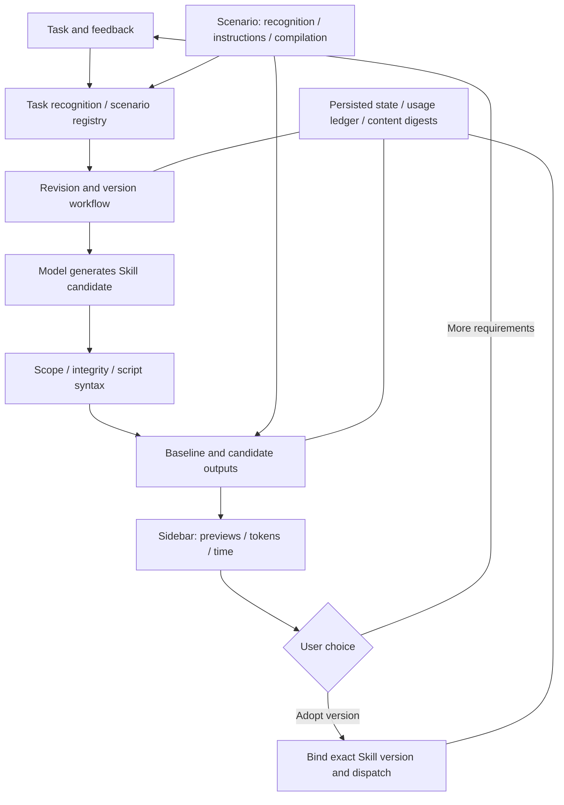

# DeepSeek RSI

**An Agent evolution plugin with users in control.** The current user-facing workflow revises Skills inside DeepSeek Harness: compare old and new outputs with previews, tokens and elapsed time, then choose a version or give feedback for another iteration. The first additional object, a read-only repository execution policy, now has [fixed-response execution gates](POLICY-REPORT.md) and [explicit sidebar review/adoption/restoration](POLICY-REVIEW-REPORT.md).

Repository: [B1ackB/DeepSeek-RSI](https://github.com/B1ackB/DeepSeek-RSI). Current development version: `0.0.0-g2.5`.

## Purpose

An Agent's behavior depends on the Skills it loads as well as its model: task methods, writing rules, reference material, and helper scripts. This project turns those editable resources into recorded, reviewable candidate versions so users can refine their Agents over time.

RSI here means **controlled iteration of explicitly supported Agent behavior**. Skill evolution is the current UI workflow. The repository-evidence-policy developer path generates scoped candidates, seals versions and separately authorizes fixed comparisons through independent native Agent children. The model proposes content within scope. The host controls authorization, versions, accounting and fixed checks. The user decides adoption. The plugin does not change model weights, the Harness controller or its own permissions, and does not switch versions automatically. The sidebar supports explicit policy review, workspace adoption/restoration and immutable dedicated pilot-session bindings under the fixed-response contract.

## Workflow

1. Submit a webpage request in Harness, or explicitly select another directory-backed Skill with `/skill-name task description`.
2. Confirm requirements, preference scope, complete input files, editable paths, and budget in the sidebar. Web tasks offer optional page-purpose and style cards; other scenarios use general requirement input.
3. The model produces an independent Skill candidate. The host validates scope, file integrity, and Python/Shell syntax, then shows the complete diff.
4. Optionally confirm a separate comparison budget to generate one output with each version. The sidebar shows embedded previews, links, token bars, and generation/compilation time. Usage comes from the provider ledger; unknown values remain unknown.
5. Adopt the candidate, continue with the baseline, or enter requirements for the next iteration. Another iteration preserves prior records and opens a linked confirmation card; preparing it makes no model call.
6. After adoption, the ordinary Harness task binds to the exact approved Skill version. If a session has used a different version, a linked session is created; the original retains its binding.

**Compilation is a technical threshold, not a quality score.** Fewer tokens do not automatically recommend or activate a candidate. Functional or aesthetic scores do not choose for the user. The original review path without output comparison remains available; once comparison starts, its candidate cannot be adopted until candidate compilation and related usage confirmation succeed.

## Supported scenarios

| Scenario | Comparison output | Checks | Current limits |
|---|---|---|---|
| Single webpage | Self-contained HTML, CSS, and vanilla JavaScript; separate preview links | CSS/JavaScript compilation and structured response format | No external dependencies or tools; not a multi-file project build. HTML is parsed by the browser |
| General text | Notes, explanations, writing, and other text previews | Nonempty text, size, and format | No additional project-file access or invented external execution results |
| Developer extension | HTML/text output generated under a trusted scenario's instructions | Scenario-specific compilation or format checks | Shares core accounting and version flow; more complex execution environments need explicit integration |

Web design is one built-in scenario. Other explicit directory Skills enter the general flow, and developers can register specific scenarios. Web project/personal preferences do not leak into general text scenarios.

## Architecture



One TypeScript plugin package contains the host and browser components. Small interfaces separate shared workflow from scenario-specific behavior. The browser submits intent; the host validates state transitions.

| Entry point | Responsibility |
|---|---|
| `src/index.ts` | Plugin lifecycle and service composition |
| `src/onboarding.ts` | Task entry and explicit Skill selection |
| `src/mainflow.ts` | Authorization, candidates, further iterations, exact adoption, and session handoff |
| `src/candidates.ts` | Candidate scope, integrity, and script syntax |
| `src/comparison.ts` | Frozen comparison input, execution, compilation, artifacts, and authenticated previews |
| `src/scenarios/` | Web/text scenarios and developer registration |
| `src/store.ts`, `src/usage.ts`, `src/skills.ts` | Transactions, provider usage, and immutable versions |
| `src/client/` | Shared sidebar, charts, and web guidance |
| `src/g1.ts`, `src/frontend.ts` | Compatible observation/analysis and earlier design preparation |

See [architecture](ARCHITECTURE.md) for call chains and trust boundaries, and [contributing](CONTRIBUTING.md) for an extension example.

## Development and validation

The integration pins DeepSeek Harness commit `d347e703908d0406b7a7ef80e3a0e594d86b2215` and requires the [right-panel patch](../patches/harness-right-panel.patch). The plugin declares Node >=24; local validation with the existing Harness native dependencies uses Node 25.8.1. Revalidate other Harness/Node combinations.

Apply the patch and build in a separate Harness checkout. Do not reapply an already applied patch:

```sh
# In the Harness checkout; RSI_REPO is this repository's absolute path.
git apply --check "$RSI_REPO/patches/harness-right-panel.patch"
git apply "$RSI_REPO/patches/harness-right-panel.patch"
pnpm run build
```

Then run in this repository:

```sh
npm ci --ignore-scripts
npm run link:harness -- /absolute/path/to/deepseek-harness
npm run check
```

The linking script checks the Harness commit and refuses to replace a different existing link. `npm run check` runs host/client type checks, Node tests, and the build. Tests do not call real models or start Docker. The existing esbuild dependency compiles both the plugin and comparison CSS/JavaScript.

`npm run policy:fixture` runs a complete offline Agent task through the native SDK in a new owned home/profile. It loads no real provider or ambient credentials and verifies sealed policy versions, batch-owned request accounting, interruption recovery and process cleanup. Detailed results go to `.cache/policy-fixture-result.json`. Policy boundary/failure and populated-v6 compatibility checks are included in the normal test suite. Use Node 25.8.1 with the existing native dependencies, as above.

`npm run policy:comparison` runs baseline and candidate in separate children sharing one persisted batch. It retains a new controller database/result in a unique `.cache/policy-comparison-<UUID>` directory and removes the owned child homes. The test suite covers six fixed repository cases, cumulative limits, failed quality checks, unknown usage, child/controller process loss and missing cleanup receipts. These are fixed-response checks, not real-model performance measurements. See the [paired evaluation report](POLICY-COMPARISON-REPORT.md).

`npm run policy:generation` exercises a scoped single-request proposer, immutable candidate sealing and a separately authorized paired evaluation. The proposer receives only the baseline, requirements and an independent development example; fixed-case answers and previous evaluation results are excluded. The command retains a new controller database/result under `.cache/policy-generation-<UUID>`. All responses remain scripted and offline. See the [generation gate report](POLICY-GENERATION-REPORT.md).

The policy sidebar keeps the current session binding separate from future workspace defaults. See the [review/session report](POLICY-REVIEW-REPORT.md) and [final code review](POLICY-FINAL-REVIEW.md) for exact approval, recovery and compatibility boundaries.

`npm run policy:snapshot -- /absolute/checkout exact/relative/file ...` collects only explicitly selected current worktree text and seals it in a new `.cache/policy-snapshot-<id>/repository-snapshots` directory. Add `--verify` to exercise the captured source through one offline native Agent task (three fixed-response requests; no paid provider). Sensitive/unsupported selections fail as a whole. No recursive discovery, Git execution, source writes or live filesystem tools are used. The optional snapshot provenance is covered by the existing conditions digest; old snapshots and SQLite rows need no rewrite. See the [snapshot contract](POLICY-SNAPSHOT-CONTRACTS.md) and [validation report](POLICY-SNAPSHOT-REPORT.md).

The policy sidebar also accepts exact workspace-relative file paths, previews their full captured text and requires explicit sealing confirmation. It recaptures before sealing and rejects changed source or stale policy/workspace state. A separate button creates a new read-only session bound to that exact sealed snapshot and approved policy; creation makes no model request. Existing sessions retain their original source. Under an existing approved baseline and sealed source, the same sidebar separately confirms candidate generation and a new independent full-task evaluation budget. The generator receives the baseline, requirements and independent development example, without selected source text or held-out answers. The first source evaluator checks search/read/first-line citation transport; it does not evaluate arbitrary repository semantics. See the [authorization contract](POLICY-AUTHORIZATION-CONTRACTS.md). Fixed adapters still require an isolated fixture profile; no real-model route is enabled.

For development, start from the built Harness checkout with a separate `DSH_HOME` and this repository's patch:

```sh
DSH_HOME=/absolute/path/to/rsi-dev-home DSH_TELEMETRY_MODE=DISABLED \
 node --import tsx/esm apps/cli/src/bin.ts web \
 --patch /absolute/path/to/DeepSeek-RSI/cordis.patch.yml --no-open
```

Use the authenticated launch link. Do not install a second RSI copy into the same profile. Harness manages credentials; do not commit authentication links, credentials, or local databases.

If a Skill request appears to receive no chat reply, open the **RSI** sidebar first. The confirmation card pauses the ordinary Agent before its first model request; fill in the preference and confirm the displayed scope and budget, or select **用旧版继续** to run the task with the baseline. Waiting alone does not generate a candidate. Stopping the chat interrupts this wait. To retry Skill optimization after that interruption, enter a requirement under **下一轮要求** and select **带入要求，准备下一轮**; this opens a fresh confirmation card without calling a model. Confirming generation, starting a comparison, and continuing the ordinary task are separate actions that can incur model usage.

## Installation, upgrades, and data

Build a local package:

```sh
npm run build
mkdir -p .cache
npm pack --ignore-scripts --pack-destination .cache
```

Install from the patched Harness checkout, using your own `DSH_HOME`:

```sh
DSH_HOME=/absolute/path/to/rsi-home node --import tsx/esm apps/cli/src/bin.ts \
 plugin --profile web add /absolute/path/to/DeepSeek-RSI/.cache/b1ackb-deepseek-rsi-0.0.0-g2.5.tgz --ignore-scripts
```

Stop the profile's host and back up all of `DSH_HOME/rsi` before upgrading. This development version uses SQLite **7**, appending policy version/batch/generation/choice/session tables while retaining terminal historical rows byte-for-byte; it does not insert policy defaults into the old business JSON. Earlier upgrades still add their scenario/comparison defaults. Startup interrupts unfinished work without replay. Older packages cannot read version 7, and earlier v7 development builds can reject new policy metadata and commands; downgrade using the complete stopped-host backup, including objects and artifacts. Uninstall with `plugin --profile web remove @b1ackb/deepseek-rsi` in the same profile; it does not clear RSI data.

Comparison artifacts live under `DSH_HOME/rsi/artifacts`, Skill versions under `objects`, sealed policy content under `policies`, and repository source objects under `repository-snapshots`. The database remains `g0.sqlite` for compatibility and appends `policy_sources` preview/seal records within the unreleased v7 path. Back up these directories together. The policy sidebar supports explicit source-bound generation and separately authorized evaluation, review, adoption/restoration and new dedicated sessions. Optional generation source bindings and new command receipts are added without rewriting old v7 rows; older strict readers may reject them. Generation alone never authorizes evaluation or adoption. Preview links require the running Harness and browser authentication. They are local previews, not public deployments; stopping the host or changing its port can invalidate an old address.

## Evidence and limits

- See the [g2.5 report](COLLABORATION-REPORT.md) for implementation and validation. Earlier g2.4 work and real experiment evidence are retained.
- The historical real experiment completed Skill rewriting and old/new single-page generation, but the candidate had an extra button with no feedback. Under the current rules, the user judges such behavior; the historical report's original conclusion remains preserved.
- Fixed-response tests establish workflow, accounting, and boundary behavior, not lasting model improvement. Every new paid batch requires its own explicit budget.
- This is a local development version on a pinned host. It has no unattended automatic selection, general multi-file builder, public preview hosting, team permission system, or marketplace.
- No open-source license has been selected; the package remains `private: true`. Publication and licensing are maintenance decisions still to be made. The extension entry point is not a promise of a stable cross-version SDK.
- Documentation is English. Runtime fixtures, original model outputs, confirmed inputs, and screenshots retain their source language and bytes so historical evidence remains verifiable. The product UI remains Chinese.

## Documentation index

| Need | Document |
|---|---|
| Purpose, workflow, installation | This README |
| Product boundaries and roadmap | [FRAMEWORK.md](FRAMEWORK.md) |
| Proposed Agent evolution scope and first policy pilot | [EVOLUTION-PILOT-PLAN.md](EVOLUTION-PILOT-PLAN.md) |
| Repository policy contract and fixture execution boundary | [POLICY-CONTRACTS.md](POLICY-CONTRACTS.md) |
| Repository policy first-gate implementation evidence | [POLICY-REPORT.md](POLICY-REPORT.md) |
| Repository policy sealing, v7 migration and batch accounting evidence | [POLICY-PERSISTENCE-REPORT.md](POLICY-PERSISTENCE-REPORT.md) |
| Shared policy batches and fixed full-task evaluation | [POLICY-COMPARISON-REPORT.md](POLICY-COMPARISON-REPORT.md) |
| Scoped policy generation, separate authorization and closed-loop fixture | [POLICY-GENERATION-REPORT.md](POLICY-GENERATION-REPORT.md) |
| Explicit policy review, workspace choices and immutable session bindings | [POLICY-REVIEW-REPORT.md](POLICY-REVIEW-REPORT.md) |
| Final review of exact selection, native resume and version restoration | [POLICY-FINAL-REVIEW.md](POLICY-FINAL-REVIEW.md) |
| Real worktree capture, sensitive exclusions and immutable snapshot binding | [POLICY-SNAPSHOT-CONTRACTS.md](POLICY-SNAPSHOT-CONTRACTS.md), [validation](POLICY-SNAPSHOT-REPORT.md) |
| Sidebar file selection, explicit sealing and exact source session binding | [POLICY-SOURCE-UI-REPORT.md](POLICY-SOURCE-UI-REPORT.md) |
| Sidebar generation and separate source evaluation authorization | [POLICY-AUTHORIZATION-CONTRACTS.md](POLICY-AUTHORIZATION-CONTRACTS.md), [validation](POLICY-AUTHORIZATION-REPORT.md) |
| Modules, call chains, trust boundaries | [ARCHITECTURE.md](ARCHITECTURE.md) |
| Collaboration, scenario extensions, review | [CONTRIBUTING.md](CONTRIBUTING.md) |
| Comparison, iterations, migration | [EXTENSION-CONTRACTS.md](EXTENSION-CONTRACTS.md) |
| Versions, accounting, foundational contracts | [CONTRACTS.md](CONTRACTS.md) |
| Web design and preference scope | [FRONTEND-SCENARIO.md](FRONTEND-SCENARIO.md) |
| Earlier observation/preparation protocols | [G1-CONTRACTS.md](G1-CONTRACTS.md), [G2-CONTRACTS.md](G2-CONTRACTS.md) |
| Current delivery evidence | [COLLABORATION-REPORT.md](COLLABORATION-REPORT.md) |
| Historical validation | [g2.4](LIVE-GUIDANCE-REPORT.md), [real comparison](evidence/g2.4-real/README.md), [g2.3](MAINFLOW-REPORT.md), [G2 preparation](G2-REPORT.md), [G1](G1-REPORT.md), [G0](G0-REPORT.md) |
| Environment and source research | [HARNESS-LOCAL.md](HARNESS-LOCAL.md), [SOURCE-REVIEW.md](SOURCE-REVIEW.md) |
| Archived design | [HISTORY-FRAMEWORK-G2.4.md](HISTORY-FRAMEWORK-G2.4.md) |
| Repository rules | [AGENTS.md](../AGENTS.md) |
